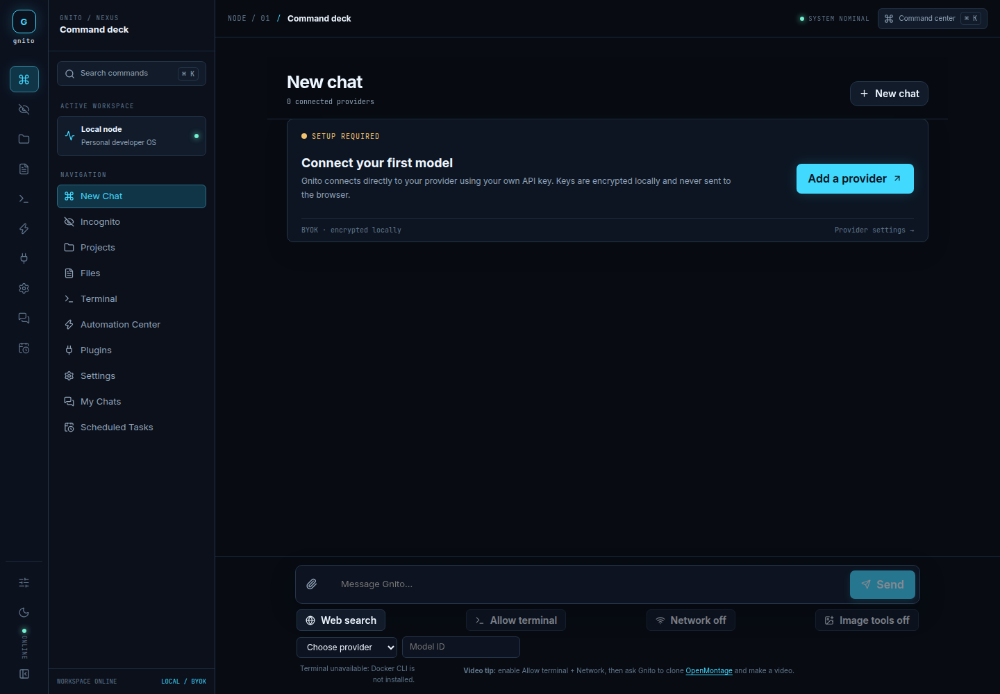
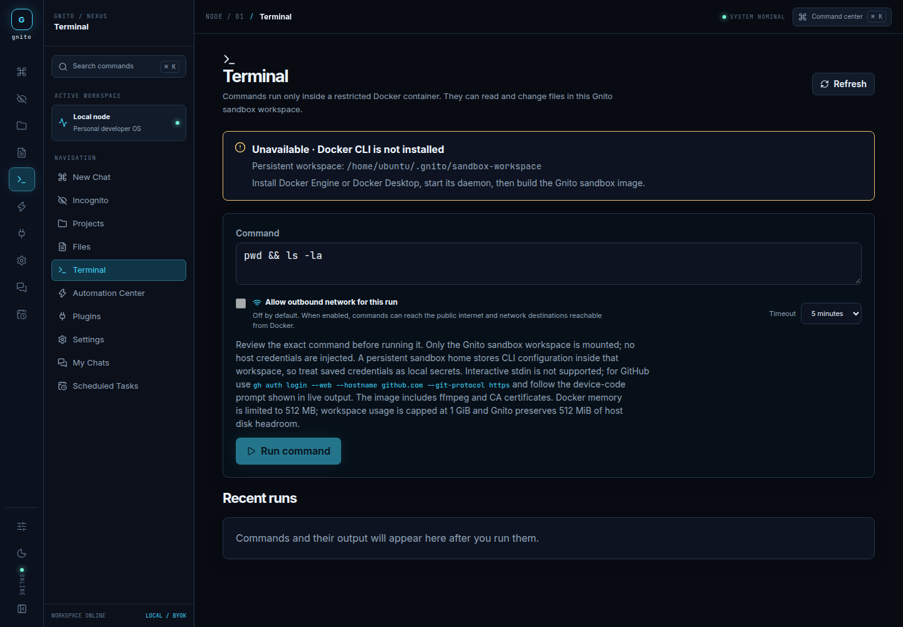
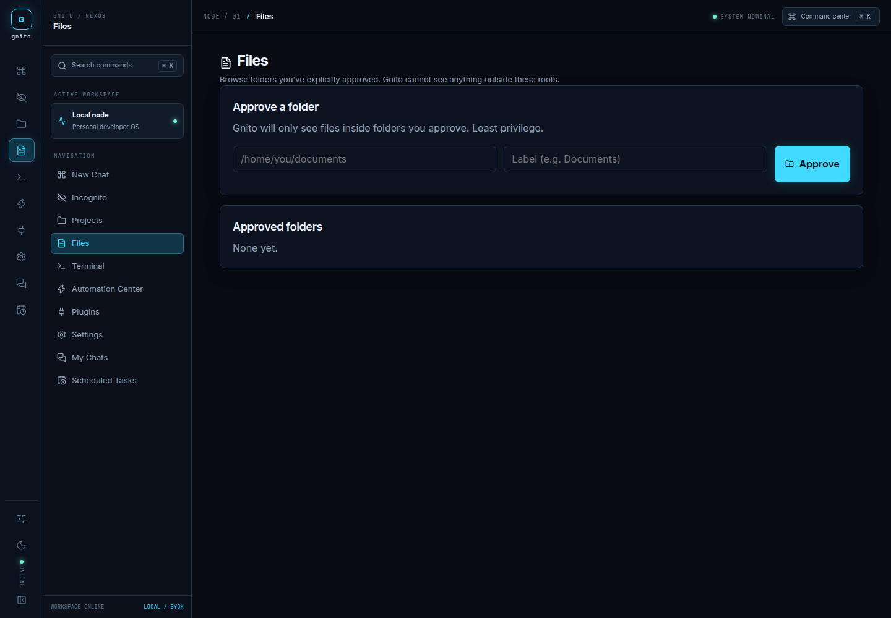
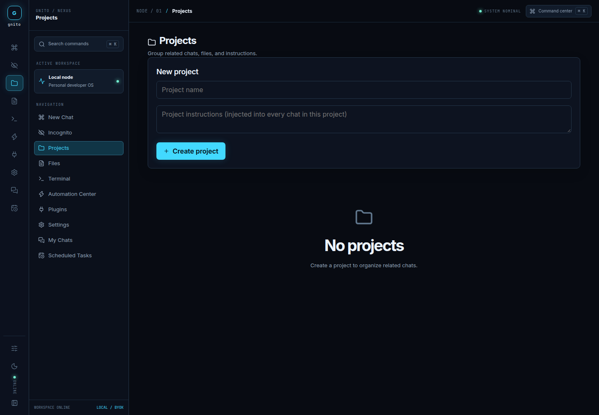
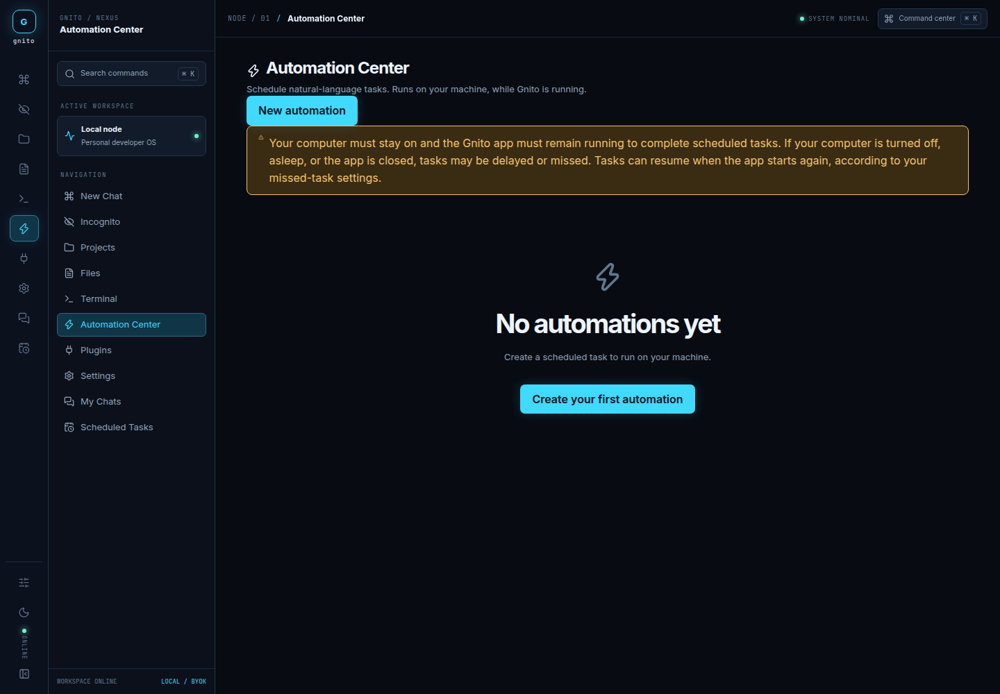
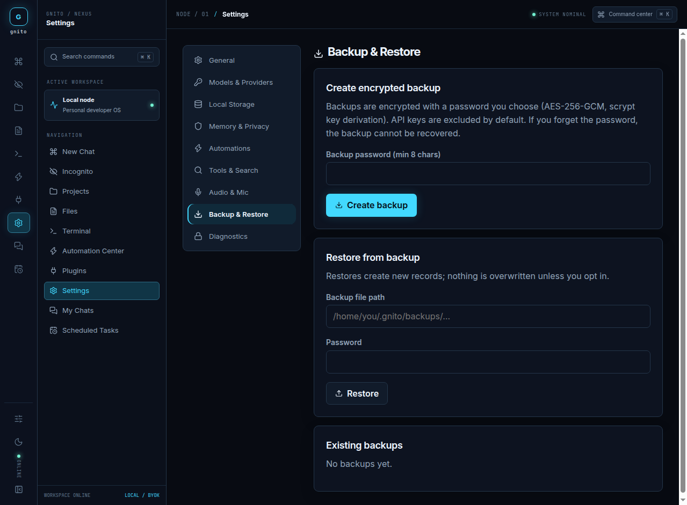

# Gnito — NEXUS

**A local-first AI developer operating environment.**

Gnito is an open-source, self-hosted workspace for developers who want an AI system close to their code, files, tools, and data. It runs on your machine, keeps persistent state in a local data directory, and connects to the model providers you choose through a bring-your-own-key (BYOK) configuration.

The current frontend direction is **NEXUS**: a futuristic but practical developer environment built around an icon rail, workspace drawer, command-oriented chat canvas, optional inspector, terminal tooling, files, projects, plugins, and automations. The interface is designed for long development sessions rather than for a generic AI dashboard.

> [!IMPORTANT]
> Gnito does not bundle or subsidize a model. External provider usage can incur charges, quotas, rate limits, and data-processing policies determined by the provider you configure. Image generation may incur additional provider charges. Review provider terms and every tool/network permission before use.

## Preview

### Chat workspace



### Terminal



### Files



### Projects



### Automation Center



### Settings



These previews show six distinct areas of the same local developer environment. The chat preview is shown before a provider is configured; after setup, the canvas becomes the full conversation and developer command surface.

## Why Gnito exists

Most AI chat applications separate the assistant from the environment where development actually happens. Gnito is designed around the opposite idea: the assistant, conversation history, files, terminal, projects, providers, automations, and plugins belong to one local workspace.

The project is made for people who want:

- Control over which provider receives a request.
- Local persistence for chats, projects, memory, settings, automations, and tool history.
- Explicit, per-message permission for terminal execution, network access, web search, and image tools.
- A developer-oriented environment instead of a chat-only interface.
- A self-hosted system that can work with cloud providers, local models, or compatible private endpoints.

Gnito preserves the underlying product capabilities while allowing the frontend experience to evolve independently. The NEXUS branch is a visual and interaction transformation, not a replacement backend.

## Features

### AI workspace

- Streaming chat over SSE with cancel, retry, edit, and message actions.
- OpenAI-compatible, Anthropic-compatible, Ollama, LM Studio, vLLM, and custom provider endpoints.
- Provider and model selection inside the chat command surface.
- Prompt attachments for up to four local images or text/code files per message.
- Markdown, GitHub-Flavored Markdown, syntax-highlighted code, and generated media previews.
- Opt-in web search with source links retained alongside the conversation.
- Explicit per-message terminal, network, and image-tool permissions.

### Developer tools

- **Terminal:** one-shot commands inside a restricted Docker workspace with visible command/output history.
- **Files:** browse, read, edit, and delete files only inside explicitly approved folders.
- **Projects:** group chats and project-specific instructions.
- **Plugins:** extend Gnito with integrations such as the GitHub plugin.
- **Automation Center:** schedule provider/model-specific natural-language tasks through the local scheduler.
- **Command Center:** keyboard-first navigation and actions with `Ctrl/Cmd+K`.

### Privacy and safety

- Local SQLite database and file storage under `~/.gnito/` by default.
- Provider keys encrypted at rest in the local vault.
- Incognito chats held temporarily and excluded from history, memory, and backups.
- Session-token and CSRF protection on API routes.
- Terminal commands run in a dedicated Docker sandbox; host-shell fallback is not used.
- Docker networking is disabled unless explicitly enabled for a specific message.
- Path traversal and symlink escapes are blocked on file routes.
- Encrypted password-protected backups using AES-256-GCM and scrypt.

## Architecture

Gnito is a TypeScript application with a Vite/React client and a Node server.

```text
src/
├── client/
│   ├── App.tsx                 # client routing and app composition
│   ├── ui/AppShell.tsx         # NEXUS rail, drawer, canvas, and inspector shell
│   ├── features/chat/          # chat state, streaming, tools, attachments, markdown
│   ├── features/files/         # approved-folder file workflows
│   ├── features/terminal/      # terminal UI and command history
│   ├── features/projects/      # project workspace UI
│   ├── features/automations/   # scheduled task UI
│   ├── features/plugins/       # plugin management UI
│   ├── features/settings/      # provider, memory, privacy, and app settings
│   └── styles/                 # base tokens plus the active NEXUS visual system
├── server/                     # APIs, auth, providers, storage, scheduler, sandbox
└── shared/                     # shared types and provider definitions
```

The frontend communicates with the existing backend APIs. The redesign does not replace provider adapters, database code, authentication, storage, terminal isolation, or scheduled-task execution.

## Quick start

### Requirements

- Node.js **20.19 or newer**.
- Docker Engine or Docker Desktop is optional for chat and most UI features, but required for Terminal and agent command execution.
- A compatible model provider and API key, unless you plan to use a local provider such as Ollama or LM Studio.

### Development

```bash
git clone https://github.com/V-Dev-arch/gnito.git
cd gnito
npm install
npm run dev
```

Open [http://localhost:5173](http://localhost:5173).

The development command runs the Vite client and the local API server together. The API server listens on `127.0.0.1:8377` by default while Vite serves the development client on port `5173`.

### Production

```bash
npm install
npm run build
npm start
```

The production server serves the built frontend and API from one origin at [http://127.0.0.1:8377](http://127.0.0.1:8377).

### Useful development commands

```bash
npm run typecheck   # TypeScript validation for server and client
npm run lint        # ESLint with warnings treated as errors
npm test            # Vitest unit and integration suite
npm run build       # Production client and server build
```

## First-run setup

1. Start Gnito with `npm run dev`.
2. Open **Settings** from the NEXUS rail or workspace drawer.
3. Add a provider and enter the model identifier if model discovery is unavailable.
4. Return to **New Chat** and choose the provider/model in the composer.
5. Enable only the tools needed for the current message.

Provider keys are stored in the encrypted local vault. Gnito does not send keys to the browser or include them in model prompts.

## Terminal sandbox

Terminal execution is intentionally opt-in and isolated. Build the prepared image using the instructions in [`docs/terminal-sandbox.md`](docs/terminal-sandbox.md), then enable **Allow terminal** in a chat message.

Network access is a separate per-message permission. When enabled, commands can use Docker bridge networking; otherwise command networking is disabled. The sandbox includes `ffmpeg` for local media workflows and exposes only the dedicated Gnito workspace, not the host filesystem.

For video workflows, enable **Allow terminal** and **Network**, then ask Gnito to clone [OpenMontage](https://github.com/calesthio/OpenMontage), follow its README, and save output under `/workspace`. Review commands and any external service or provider charges before proceeding.

## Memory and Incognito

Enable Memory under **Settings → Memory & Privacy** before asking Gnito to remember a preference:

> Remember that I prefer concise answers and use metric units.

Memory is local, opt-in, user-editable, and excluded from Incognito sessions. Incognito conversations are temporary and are not written to chat history, memory, or backups. External providers may still process anything you send to them.

## Data location

Everything Gnito persists lives under `~/.gnito/`, configurable with `GNITO_DATA_DIR`:

| Path | Contents |
|---|---|
| `~/.gnito/gnito.db` | SQLite database containing chats, projects, memory, automations, settings, and tool runs |
| `~/.gnito/secrets.enc` | Encrypted provider API keys and plugin secrets |
| `~/.gnito/.gnito-master-key` | Vault master key, normally mode `0600` |
| `~/.gnito/backups/` | Encrypted backup archives |
| `~/.gnito/sandbox-workspace/` | Files available to Docker terminal runs, with a monitored cap |
| `~/.gnito/generated-media/` | Locally stored generated images and other media |

## GitHub plugin

Open **Plugins → GitHub**, create a narrowly scoped personal access token, and connect it. The token is encrypted locally and is never exposed to the model. GitHub continues to enforce the token’s scopes and fine-grained repository permissions. Review write and destructive operations before running them.

## Security model

- The server binds to loopback (`127.0.0.1`) by default.
- Network deployments require an exact `GNITO_TRUSTED_ORIGINS` allowlist; this is not a replacement for user authentication.
- API routes use session-token and CSRF protections.
- Provider keys and GitHub tokens are never logged or returned to the client.
- File operations enforce approved-folder permissions and prevent path traversal/symlink escape.
- Terminal runs require Docker, use a non-root OS user, and mount only the dedicated sandbox workspace.
- Container networking is disabled unless explicitly allowed per message.
- Memory is opt-in and never persists from Incognito sessions.

See [`docs/security.md`](docs/security.md) for the full threat model and operational notes.

## Documentation

- [`docs/architecture.md`](docs/architecture.md) — system design and module layout
- [`docs/security.md`](docs/security.md) — threat model and security notes
- [`docs/terminal-sandbox.md`](docs/terminal-sandbox.md) — Docker setup and sandbox limits
- [`docs/design-system.md`](docs/design-system.md) — tokens, themes, and accessibility
- [`docs/plugin-sdk.md`](docs/plugin-sdk.md) — writing a plugin
- [`docs/implementation-status.md`](docs/implementation-status.md) — complete and partial features
- [`CONTRIBUTING.md`](CONTRIBUTING.md) — contribution workflow

## Contributing

Changes should preserve the existing backend contracts, security boundaries, and user workflows. Frontend redesigns may replace the presentation and composition, but should continue to use the existing APIs and real feature handlers rather than mock interactions.

Run the full validation suite before opening a pull request:

```bash
npm run typecheck
npm run lint
npm test
npm run build
```

## License

MIT — see [`LICENSE`](LICENSE).
